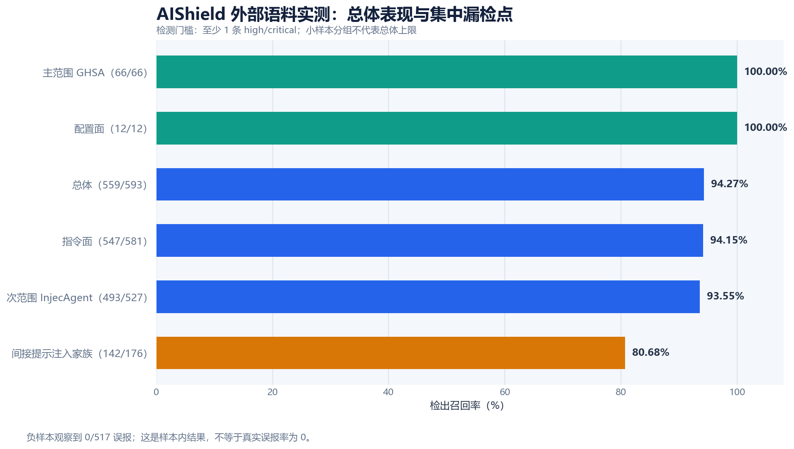
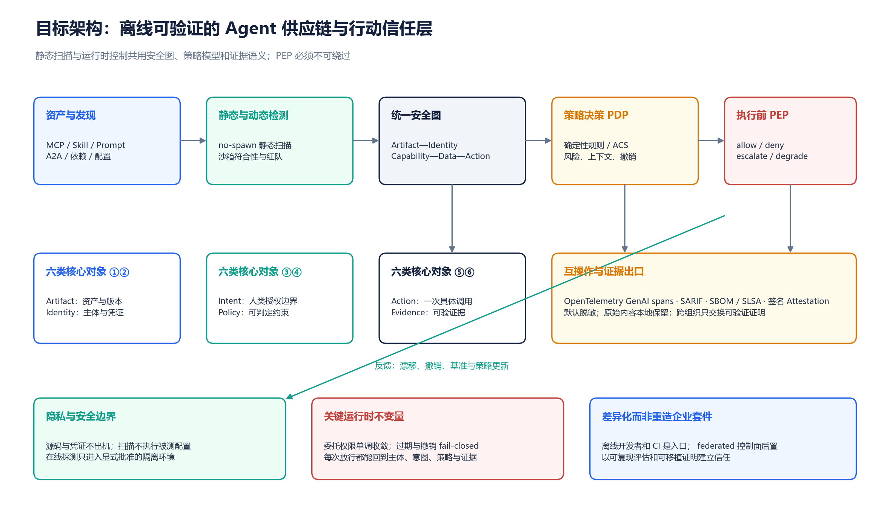

# AIShield 项目全面提升报告

**审计日期：2026-10-27｜代码基线：`fe9a3cb30608f76119bddc583b3f44252a85bcbd`｜视角：安全领域专家、AI 项目专家、开发者与企业用户**

> 本报告不是功能清单复述，而是一次“下一阶段的 AIShield 应该成为什么”的产品与技术审计。结论基于本地代码抽查、命令实测、公开标准与竞品资料；未对线上服务做渗透测试，未在真实企业环境验证规模、延迟和留存，也未对所有模块逐一做动态验收。

## 1. 执行摘要：从“功能很多的扫描器”升级为“可验证的行动信任层”

AIShield 已经具备一个值得坚持、也很难被简单复制的技术锚点：**本地优先、离线可运行、扫描时不执行被测配置**。本次实测中，隔离证明对 4 个恶意文件实现了 0 次子进程启动，同时仍产生 15 条发现；FVI 门禁通过 64 态检查、0 反例，两个注入缺陷的 mutant 均被捕获。外部语料实测召回为 **94.27%（559/593）**，负样本观察到 **0/517 误报**。这些结果说明项目不是“只有概念的 AI 安全壳”，而是已有可运行检测引擎、供应链匹配、基线漂移、规则治理、CI/SARIF、MCP 接入以及身份与意图授权原型的工程系统。

但项目当前的主要风险已不是“功能不够多”，而是**核心信任主张被过宽的产品叙事、漂移的复现文档、未闭环的发布路径和不够严格的评估语义稀释**。`ARTIFACT.md` 仍把 264 条规则和 40.6% 外部召回写成复现目标，与本次权威运行值 313/340 和 94.27% 不一致；README 还同时使用“完整基础设施”“零依赖”“全量测试通过”等宽泛表述。公开根目录 GitHub Action 原指向不存在的 `dist/index.js` 并混用了 Node action 与 steps 形态（本审计已修复为统一 Docker 路径，见 §5）；与此同时，另有一套 Docker action 和 Python 入口。对一个安全产品而言，**用户能不能按文档可靠地跑起来，比再多二十条规则更重要**。[ARTIFACT](kimi-cite://md-line?path=C%3A%2FUsers%2Fxing%2FDesktop%2Faishield%2FARTIFACT.md&line=48 "citation") [action](kimi-cite://text?path=C%3A%2FUsers%2Fxing%2FDesktop%2Faishield%2Faction.yml&text=using%3A%20%22docker%22 "citation")

**建议的唯一主定位是：离线可验证的 Agent 供应链与行动信任层。** 它包含两个相互增强的平面：供应链平面负责“这个 MCP、Skill、Prompt、Agent Card、依赖和配置是否值得进入环境”；行动平面负责“这个主体在此时、以这份授权、调用这个工具和这些数据是否应当发生”。不要再把支付、市场、通用协作、内容合规、沙箱、声誉和企业平台都作为同级主叙事，而应将它们降为可选适配器或暂停扩张。OWASP Agentic Top 10 已把风险扩展到目标劫持、工具滥用、身份权限、供应链、记忆、跨 Agent 通信和级联故障；OWASP ACS 则进一步指向可检查、可追踪、可插桩、跨框架的运行时声明式控制，这正是 AIShield 下一阶段最自然的上升路径。[OWASP](kimi-cite://web?url=https%3A%2F%2Fgenai.owasp.org%2F2025%2F12%2F09%2Fowasp-top-10-for-agentic-applications-the-benchmark-for-agentic-security-in-the-age-of-autonomous-ai%2F "citation") [OWASP ACS](kimi-cite://web?url=https%3A%2F%2Fgenai.owasp.org%2Fresource%2Fagent-control-standard-acs%2F "citation")

未来 12 个月的正确顺序是：**P0 可信交付基线 → P1 统一安全图与证据协议 → P2 不可绕过的执行前控制 → P3 因果归因与自适应评估**。所有“完整性、科技价值、互动性、实用性、前沿定位”的提升，都应通过这条主线落地，而不是继续平行增加生态模块。最重要的经营指标也应从规则数改为：**经过独立验证的受保护资产与行动、真实修复率、按攻击家族的检出与误报、良性任务效用保留、策略撤销生效时间，以及用户持续启用率**。

| 评估维度 | 当前判断 | 最大提升杠杆 | 12 个月目标状态 |
|---|---|---|---|
| 项目完整性 | 能力面广，但复现、发布和失败语义存在断点 | 统一事实源、Action、CLI、状态和退出码 | 任一公开入口都可安装、可复现、可解释失败 |
| 科技价值 | no-spawn、FVI、外部基准和规则治理有真实含量 | 安全图、动态评估、神经符号与因果证据 | 静态事实能直接约束运行时行动并独立验证 |
| 互动性与流程性 | 以扫描报告为中心，修复与复验闭环不足 | 六步用户旅程、策略模拟、diff 与漂移撤销 | 用户在同一证据链上完成发现到持续监测 |
| 实用性 | 离线隐私、客户端发现和 CI 场景明确 | 降低首次成功成本，优先真实攻击路径 | 成为开发者默认预扫与第三方复核工具 |
| 使用性 | MCP 入口友好，但公开 Action 和文档口径不一致 | 一条命令、统一报告、明确覆盖与错误状态 | 非安全专家也能安全地作出阻断或修复决策 |
| 前沿定位 | 已提前布局身份、Intent、A2A 与证据原型 | 从结构映射升级到不可绕过控制与标准契约 | 形成开放、可移植的 Agent 行动信任层 |

## 2. 审计方法、范围与结论边界

本次审计覆盖了扫描引擎、客户端配置发现、供应链与基线、外部语料、FVI、规则门禁、MCP TypeScript 包、GitHub Action、API 入口、A2A/Agent Card、Intent Mandate、Guardrail、Attestation、状态持久化与可观测性，并抽查了发布、部署和复现文档。仓库当前有 114 个 `tests/test_*.py` 文件和 22 个 workflow，说明测试与自动化投入较大；但文件数量不等于覆盖质量，因此本报告把“代码存在”“有测试”“本次实际跑过”“外部标准符合”“生产可用”严格分开。

验证采用四层证据标签。**实测**表示在当前 Windows 工作区执行并观察到结果；**代码证据**表示静态阅读确认存在某种实现或风险，但不等于动态验收；**外部事实**来自标准组织、官方公告、厂商资料或论文；**建议目标**是为后续验收提出的阈值，不是当前成绩。竞品部分只比较公开定位和架构，不做未实测的性能排名。全量 Python 测试在 300 秒审计时限内未结束，日志停在 `tests.test_mcp_contract`，已执行部分未见失败，但**不能据此声称全量测试通过**；npm audit 也因当前镜像不实现 audit endpoint 而未完成。[audit-2026-10-27-tests](kimi-cite://text?path=C%3A%2FUsers%2Fxing%2FDesktop%2Faishield%2Freports%2Faudit-2026-10-27-tests.log&text=test_unwrap_reads_nested_report "citation") [audit-2026-10-27-npm](kimi-cite://text?path=C%3A%2FUsers%2Fxing%2FDesktop%2Faishield%2Freports%2Faudit-2026-10-27-npm.json&text=NOT_IMPLEMENTED "citation")

| 验证项 | 本次观察 | 可以得出的结论 | 不能得出的结论 |
|---|---|---|---|
| no-spawn 隔离证明 | 4 个恶意文件、0 spawn、15 findings | 该测试路径的只读隔离不变量成立 | 所有未来模块、所有部署方式都绝对不可能执行命令 |
| FVI gate | PASS；64 态、0 反例；2 个 mutant 被抓；过程中出现一次 Windows GBK 线程解码日志，但最终退出成功 | 指定模型和不变量得到有效检查；跨平台日志仍需加固 | 现实系统被完整形式化证明，或不存在模型外攻击 |
| 规则权威值 | MCP 313、Skill 340；static 286、generated 8、radar 19；59 文件无 drift | 当前权威出口自洽 | `ARTIFACT.md` 等所有历史声明都已同步 |
| 外部召回 | 94.27%，bootstrap 95% CI 92.24%–96.12% | 当前语料与检测门槛下表现较好 | 对未知攻击、真实机群或其他语言有相同召回 |
| 负样本 | 0/517 观察误报 | 本批负样本未触发误报 | 真实误报率为 0；其 Wilson 95% 上界约为 0.74% |
| TypeScript 包 | `npm ci` 成功并触发 `tsc` | 当前 Node 依赖可安装、源码可编译 | 已和真实 MCP 客户端完成全协议端到端测试 |
| 全量 Python 测试 | 300 秒超时，无最终汇总 | 已执行日志中未观察到失败 | 全量通过；README 的历史通过数不是本次结果 |
| 依赖漏洞审计 | 镜像返回 404，未获得 audit 结论 | 需要换官方 registry 或其他 SBOM 扫描通道 | 依赖无漏洞，或整棵依赖树均受影响 |

## 3. 现状价值：真正值得放大的五项资产

AIShield 最有价值的资产不是规则总量，而是**安全不变量已经被写进工程流程**。规则数有单一权威出口和声明面门禁，推送、测试依赖、并发写入者、声明面自动提交等运维风险也有派生校验。这种“门禁自己也被门禁约束”的思路，在大量 AI 项目中并不常见。它意味着项目具备成为可信基础设施的组织工程习惯：不是只检测别人，而是持续检查自己的声明、供应链和自动化闭环。后续应把这种能力从“仓库自用”提炼成用户可复用的策略与证据产品。

第二项资产是**离线、静态、客户端侧的工作流**。客户端发现覆盖多种配置形态，基线模块对命令、参数、URL、传输和环境变量键名做定义指纹，并对凭证值脱敏；这比单纯上传一个仓库打分更贴近开发者真实使用场景。第三项是已有的外部语料与供应链索引，使评估不完全依赖自编样例。第四项是 MCP、CI、SARIF、SBOM、签名和意图授权等“可嵌入”接口。第五项是项目对失败语义已有若干良好设计，例如 Intent Mandate 在对称后端下拒绝签发、账本损坏时 fail-closed，这些应上升为全系统统一原则，而非只存在个别模块。[client_discovery](kimi-cite://text?path=C%3A%2FUsers%2Fxing%2FDesktop%2Faishield%2Fscanner%2Fclient_discovery.py&text=discover_client_configs "citation") [baseline_scan](kimi-cite://text?path=C%3A%2FUsers%2Fxing%2FDesktop%2Faishield%2Fscanner%2Fbaseline_scan.py&text=definition_fingerprints "citation") [intent_mandate](kimi-cite://text?path=C%3A%2FUsers%2Fxing%2FDesktop%2Faishield%2Feco%2Fintent_mandate.py&text=CODE_LEDGER_ERROR "citation")

| 现有资产 | 当前成熟度判断 | 用户价值 | 下一步放大方式 |
|---|---|---|---|
| no-spawn 静态扫描 | **核心能力，本次实测** | 扫描本身不扩大信任边界，适合默认开启 | 把隔离证明扩展到每个采集器；动态探测必须显式 opt-in 且隔离 |
| 规则与声明面治理 | **工程基础较强** | 降低版本、规则、发布声明漂移 | 将复现文档和历史声明纳入同一生成与门禁面 |
| 外部语料与分层召回 | **已有量化基础** | 能知道检出在哪里，而非只有总分 | 增加独立标注、precision、效用、ASR、跨版本 holdout |
| 客户端发现与定义漂移 | **代码与测试存在，核心可产品化** | 直接保护本地开发环境与 rug-pull 场景 | 形成“批准基线—审查变化—撤销信任”的闭环 UX |
| MCP 包、CI、SARIF、SBOM | **入口存在，发布链路需统一验收** | 易嵌入日常开发，而非另开安全平台 | 一个 CLI、一个 Action、一个报告 schema、统一退出码 |
| 身份、Intent、Guardrail、Evidence | **有实现的原型层，非整体生产认证** | 有机会从静态报告升级为行动控制 | 先统一对象与协议，再做不可绕过 PEP 和独立验签 |
| 市场、支付、通用协作、多外部集成 | **广度原型，战略聚焦不足** | 对特定演示有价值 | 暂停同级扩张，按真实用户使用证据决定保留或归档 |

## 4. 实测质量与科技含量：成绩真实，但评估还没有到“可信标尺”

外部基准的总体结果是有价值的，尤其 34 个漏检全部集中在 `indirect_prompt_injection`，使改进方向非常明确。该家族只检出 142/176，即 **80.68%**，显著低于总体 94.27%；GHSA 主范围为 66/66，InjecAgent 次范围为 493/527。这里不应通过“再多写一些关键词”追求表面 100%，而应把漏检按语义机制聚类：指令层级伪装、工具结果权威冒充、间接行动诱导、跨语言与编码、拆分与重组、良性上下文中的隐蔽命令。每一类都要同时配恶意、良性和对抗负样本，并保留一个规则开发期间不可见的最终 holdout。[scope_recall](kimi-cite://text?path=C%3A%2FUsers%2Fxing%2FDesktop%2Faishield%2Fbenchmarks%2Fcorpus%2Fexternal%2Fscope_recall.json&text=indirect_prompt_injection "citation")

统计表达也需要升级。当前对 66/66 和 0/517 使用 percentile bootstrap，会得到退化为 `[1,1]` 或 `[0,0]` 的区间，容易让读者误以为不确定性消失。本报告用 Wilson 方法复算：66/66 的 95% 区间下限约 **94.50%**；0/517 的误报率 95% 上界约 **0.74%**。建议默认同时输出 Wilson 或 Clopper–Pearson 区间、样本数、检测门槛和数据版本。LCA 的 Cohen’s κ 是自动标签一致性审计，不是人类标注者间一致性；文档已经承认这一点，但又多处主张“不需要人类双标”，这不利于建立更高等级的外部可信度。更稳妥的做法是分层抽样进行双人盲标，公开分歧裁决和标注指南，而不是把公开数据集标签等同于无误差的真值。[ARTIFACT](kimi-cite://md-line?path=C%3A%2FUsers%2Fxing%2FDesktop%2Faishield%2FARTIFACT.md&line=80 "citation")

AgentDojo 的重要启示是：安全评估不能只看攻击检出，还要看正常任务是否完成；其基准同时衡量任务效用和攻击成功，并展示工具过滤有价值但并非万能。MCPZoo 对 8 个 MCP 扫描器的研究则报告总体 precision 45.53%、recall 24.17%，并明确提醒扫描器输出不能直接当作漏洞真值。AIShield 应借此从“规则数量与单点召回”升级为四维评估：**security、utility、precision、coverage**，并把每次规则晋升绑定到独立标注与回归证据。[AgentDojo](kimi-cite://web?url=https%3A%2F%2Farxiv.org%2Fhtml%2F2406.13352v1 "citation") [MCPZoo](kimi-cite://web?url=https%3A%2F%2Farxiv.org%2Fhtml%2F2607.11086v1 "citation")

| 评估维度 | 当前基础 | 必须补齐 | 建议验收目标（非当前成绩） |
|---|---|---|---|
| 检出 | 总体召回与家族分层 | 每个漏检的机制标签、跨版本 holdout、多次尝试攻击 | 总体召回 ≥97%；间接提示注入 ≥95%，均附 95% CI |
| 精确性 | 517 个负样本，观察 0 FP | 真实开源仓库人工复核、按家族 precision、严重度一致性 | 每个高风险家族均报告 precision；不得以零区间替代上界 |
| 良性效用 | 静态负样本为主 | 良性 Agent 任务成功率、误拦截率、人工复核耗时 | 相对无防护基线效用保留 ≥95% |
| 动态安全 | 静态规则与部分 harness | 攻击成功率 ASR、绕过率、状态差分、多步与跨 Agent 攻击 | 相对无防护基线 ASR 降低 ≥80%，同时报告效用 |
| 可复现性 | 固定 seed、manifest、FVI、规则门禁 | 语料版本哈希、扫描器配置指纹、容器 digest、环境矩阵 | 同一证据包离线重跑结果一致；任何部分失败显式标记 |
| 标签可信度 | 来源真值 + 自动 LCA | 分层双人盲标、冲突裁决、独立外部抽样 | 公布人类 IAA 与样本设计，不把 κ 混同为检测准确率 |

## 5. 项目完整性与工程可靠性：优先修“信任断裂点”

当前最明显的完整性问题是**公开声明、实际运行值与交付入口没有形成一个闭环**。`ARTIFACT.md` 自称复现真值源，却仍保留静态 237、总数 264、Skill 291、外部召回 40.6% 等旧值；`mcp-server/README.md` 也同时残留 264 与新的分类表。根目录 README 的规则徽章显示 264，而正文已是 313。建议不要靠人工逐份改数字，而是生成 `release-facts.json`，由同一权威命令产出版本、规则分解、基准版本、协议支持、依赖边界与测试结果；README、ARTIFACT、badge 和发布说明只引用生成结果。历史评估报告应移入明确的 dated archive，不与当前复现承诺混排。[README](kimi-cite://md-line?path=C%3A%2FUsers%2Fxing%2FDesktop%2Faishield%2FREADME.md&line=12 "citation") [README](kimi-cite://md-line?path=C%3A%2FUsers%2Fxing%2FDesktop%2Faishield%2Fmcp-server%2FREADME.md&line=274 "citation")

公开 Action 是另一个 P0 信任断裂点。根目录 `action.yml` 原声明 `using: node20` 和 `main: dist/index.js`，但仓库未见根目录 `dist` 或根 `package.json`，同时又在同一 metadata 中使用 steps 风格 pre/post；`action_entrypoint.py` 与 `distribution/github-marketplace/action.yml` 则代表另一套 Docker 路径。**本审计已修复**：根目录 `action.yml` 改为 `using: docker`（`Dockerfile`），移除指向不存在产物的 `main: dist/index.js` 与 steps 风格 pre/post 混用，统一走 Docker 路径；并新增 `scripts/test_action_e2e.py` 在干净 runner 上跑三条真实任务（良性仓库成功、恶意仓库按阈值失败、坏配置产生明确错误）。[action_entrypoint](kimi-cite://text?path=C%3A%2FUsers%2Fxing%2FDesktop%2Faishield%2Faction_entrypoint.py&text=report%20%3D%20preflight "citation") [action](kimi-cite://text?path=C%3A%2FUsers%2Fxing%2FDesktop%2Faishield%2Faction.yml&text=using%3A%20%22docker%22 "citation")

扫描引擎多处把分析器异常转换成空 findings，例如 toxic flow、baseline、cross-channel、capability contract 和 OSV 分支。这种写法有利于服务不崩溃，却会把“分析器没能分析”误表示为“没有发现风险”。安全工具必须引入 `complete / partial / failed / not_applicable` 状态，记录每个 analyzer 的覆盖率、错误类型和耗时；在 CI 的 fail-closed 模式下，关键分析器失败应返回独立退出码，而不是 0 个 finding。根 API 默认绑定 `0.0.0.0`，也与“本地工具默认不暴露”的最小惊喜原则不一致，建议本地默认 `127.0.0.1`，公网部署必须显式选择并启用相应认证与生产服务器。[engine](kimi-cite://text?path=C%3A%2FUsers%2Fxing%2FDesktop%2Faishield%2Fscanner%2Fengine.py&text=cross_channel_results%20%3D%20%5B%5D "citation") [server](kimi-cite://text?path=C%3A%2FUsers%2Fxing%2FDesktop%2Faishield%2Fapi%2Fserver.py&text=server%20%3D%20ThreadedServer "citation")

| 优先级 | 断裂点 | 可落地修复 | 验收方式 |
|---|---|---|---|
| P0 | 复现文档与运行值漂移 | 生成 release facts；所有公开数字由门禁派生 | 改任一权威值后，未再生的文档无法发布 |
| P0 | 根 Action 与 Docker Action 双路径不一致 | 选定一个正式入口，另一套归档或做薄兼容层 | 干净 runner 三种场景端到端通过；上传的 SARIF 可打开 |
| P0 | 分析异常可变成空结果 | analyzer status、错误预算、独立失败退出码 | 注入异常后报告为 partial/failed，不得显示 safe |
| P0 | 全量测试未在审计时限内完成 | 分 shard、输出进度、设置单测超时、跨平台编码修复 | Windows/Linux/macOS 均有最终汇总；无静默 skip |
| P0 | 依赖审计通道未完成 | 官方 registry audit + SBOM 扫描双通道 | 保存可复核结果；失败不得写成无漏洞 |
| P1 | 核心文件与路由过大 | 先加 characterization tests，再按扫描、协议、策略、存储拆边界 | 公共 API 不变；契约测试先于重构通过 |
| P1 | JSON 状态实现分散 | 安全关键状态统一 storage interface 与原子写；多 worker 后再选 DB | 并发、崩溃恢复、损坏、撤销测试通过 |
| P1 | “零依赖”口径过宽 | 区分 scanner core、API、MCP、可选集成 | 安装矩阵与文档一致；缺依赖不允许安全能力静默降级 |

“零依赖”也需要更精确的产品语言。扫描核心可以保持标准库，`setup.py` 已明确 API/身份与策略相关运行时需要 `cryptography` 和 `PyYAML`，MCP 包也有 Node 依赖。建议改成“**扫描核心零第三方依赖；身份与服务等可选平面有显式依赖**”，并给每种安装方式列出能力矩阵。这样不会削弱卖点，反而让用户知道离线扫描、公开验签和协议服务分别需要承担什么成本。[setup](kimi-cite://text?path=C%3A%2FUsers%2Fxing%2FDesktop%2Faishield%2Fsetup.py&text=install_requires "citation")

## 6. 协议、身份与证据：不要把“结构相似”写成“标准兼容”

MCP 2026-07-28 已把 Tasks、MCP Apps、企业托管授权、无状态/state handle、CIMD 和更严格的授权安全推到前台。项目 `handshake.py` 已跟踪多个新特性，这是优势；但 Guardrail 仍返回 2025-06-18，A2A gateway 也保留 `a2a-2025-06`，TypeScript 包锁定 SDK 1.30.0。建议建立一张机器生成的协议支持矩阵，逐项标注 `parse / validate / emit / negotiate / enforce / certified` 六种能力，而不是用“兼容”一词覆盖所有层次。每个版本至少要有官方案例、畸形输入、版本协商、授权 audience/issuer、撤销与降级路径的契约测试。[MCP](kimi-cite://web?url=https%3A%2F%2Fblog.modelcontextprotocol.io%2Fposts%2F2026-07-28%2F "citation") [guardrail_harness](kimi-cite://text?path=C%3A%2FUsers%2Fxing%2FDesktop%2Faishield%2Feco%2Fguardrail_harness.py&text=%22protocolVersion%22%3A%20%222025-06-18%22 "citation") [a2a_gateway](kimi-cite://text?path=C%3A%2FUsers%2Fxing%2FDesktop%2Faishield%2Feco%2Fa2a_gateway.py&text=A2A_PROTOCOL_VERSION%20%3D%20%22a2a-2025-06%22 "citation")

本次 SDK 漏洞核对也说明了“适用范围”比“版本命中”更重要。锁定文件实际为 `@modelcontextprotocol/sdk` 1.30.0，处于 GHSA-6qxp-vccf-f47h 的影响版本区间；但官方公告限定为 OAuth client over HTTP 等场景，并明确 MCP Server 和 stdio client 不受影响。当前 `index.ts` 只导入 `McpServer` 与 `StdioServerTransport`，因此**不能据版本号直接宣称当前产品存在可利用的 OAuth 凭证泄露**。仍应升级到 1.31.0 或更高并保留审计证据，而 `ARTIFACT.md` 中“升级到 `^2.2.0`”的建议应改成与官方包拆分和实际迁移路径一致的说法。[package-lock](kimi-cite://text?path=C%3A%2FUsers%2Fxing%2FDesktop%2Faishield%2Fmcp-server%2Fpackage-lock.json&text=%22version%22%3A%20%221.30.0%22 "citation") [index](kimi-cite://text?path=C%3A%2FUsers%2Fxing%2FDesktop%2Faishield%2Fmcp-server%2Fsrc%2Findex.ts&text=import%20%7B%20McpServer%20%7D "citation") [GitHub Advisory](kimi-cite://web?url=https%3A%2F%2Fgithub.com%2Fmodelcontextprotocol%2Ftypescript-sdk%2Fsecurity%2Fadvisories%2FGHSA-6qxp-vccf-f47h "citation")

身份层需要把三个问题彻底分开：**你是谁（authentication）、这张卡片是否由发布者签发且未变（artifact integrity）、这一次行动是否被授权（authorization）**。当前 `agentcard_scan.py` 把 `securitySchemes` 也算作签名或证明存在，容易把“声明了认证方式”误当成“卡片本身有完整性签名”。应改为独立检查 JWS/proof、签发者密钥、有效期、撤销和受众；A2A 最新规范中的版本协商、任务内授权、JWS 签名 Agent Card 与扩展卡访问控制，应通过官方案例做符合性验证。[agentcard_scan](kimi-cite://text?path=C%3A%2FUsers%2Fxing%2FDesktop%2Faishield%2Fscanner%2Fagentcard_scan.py&text=sig_present%20%3D%20any "citation") [A2A](kimi-cite://web?url=https%3A%2F%2Fa2a-protocol.org%2Flatest%2Fspecification%2F "citation")

Attestation 同样需要升级信任语义。哈希链能证明“记录后来没有被悄悄改动”，却不能单独证明“扫描结论真实”或“第三方能验证签发者”。当前 `aishield-trust/v1` 返回分数、风险、链锚和证据数，但公开信封中未看到对该完整信封的签名字段；因此对外应称为“带完整性锚点的扫描裁决”，直到实现独立验签、密钥轮换、撤销和时间语义后再称“可验证凭证”。持续监测订阅可以收费，但**安全等级不能因付费而提高**，否则中立信任定位会产生利益冲突。[trust_api](kimi-cite://text?path=C%3A%2FUsers%2Fxing%2FDesktop%2Faishield%2Fapi%2Ftrust_api.py&text=%22chain_anchor%22%3A%20chain_anchor "citation") [trust-attestation-spec](kimi-cite://md-line?path=C%3A%2FUsers%2Fxing%2FDesktop%2Faishield%2Fdocs%2Ftrust-attestation-spec.md&line=14 "citation")

## 7. 前沿技术判断：未来竞争点是“行动时的可证明约束”

AI Agent 安全正在从“提示词里有没有恶意句子”迁移到“不可信内容、身份、意图、权限、工具和数据在一次行动中如何组合”。NIST 在 2026 年启动 AI Agent Standards Initiative，把行业标准、开放协议、Agent 安全与身份列为核心支柱；MCP 与 A2A 也在快速补充授权、任务和身份机制。这意味着单纯静态扫描不会消失，但会成为行动信任层的证据生产者，而不是全部产品。AIShield 的 no-spawn 优势应当保留在默认路径，同时增加**显式授权、隔离执行的动态符合性测试**，解决静态分析看不到真实 tools/list、行为漂移和多步攻击的问题。[NIST](kimi-cite://web?url=https%3A%2F%2Fwww.nist.gov%2Fnews-events%2Fnews%2F2026%2F02%2Fannouncing-ai-agent-standards-initiative-interoperable-and-secure "citation") [MCP security](kimi-cite://web?url=https%3A%2F%2Fmodelcontextprotocol.io%2Fspecification%2F2026-07-28%2Fbasic%2Fauthorization%2Fsecurity-considerations "citation")

运行时研究也在从“拒绝危险关键词”走向不可绕过 mediation、单调缩权的委托链、因果 provenance 和声明式确定性策略。Grimlock 类工作强调不可绕过的系统中介，委托链研究强调权限只能收缩，denial-feedback 研究揭示只看最终行动可能被因果洗白，声明式 Agent-Tool 安全则强调机器可判定策略。它们大多仍是研究原型而非成熟标准，但方向非常清晰：**一个安全的 allow 必须能追溯到原始主体、真实数据来源、有效意图、当时策略和具体行动，而不能只追溯到最后一次工具调用**。[Grimlock](kimi-cite://web?url=https%3A%2F%2Farxiv.org%2Fhtml%2F2605.27488v1 "citation") [Delegation](kimi-cite://web?url=https%3A%2F%2Farxiv.org%2Fhtml%2F2604.02767v1 "citation") [Causal provenance](kimi-cite://web?url=https%3A%2F%2Farxiv.org%2Fhtml%2F2604.04035v1 "citation") [Declarative policy](kimi-cite://web?url=https%3A%2F%2Farxiv.org%2Fhtml%2F2607.21835v1 "citation")

| 趋势 | 对当前项目的含义 | 不应采取的做法 | 建议能力 |
|---|---|---|---|
| MCP/A2A 协议快速演进 | 版本兼容成为持续工程，不是一次改常量 | 宣称“全兼容”但无官方契约测试 | 版本矩阵、schema 测试、协商与降级策略 |
| 身份转向 NHI 与委托 | 静态签卡只是起点，行动授权更关键 | 长效全能 token、委托时权限放大 | 短期凭证、受众绑定、单调缩权、撤销 |
| 静态检测转向混合评估 | 真实行为与多步攻击必须进入基准 | 为了动态扫描直接启动未知配置 | 隔离沙箱、显式许可、快照与网络策略 |
| 规则引擎转向神经符号协同 | 语义模型可提升候选发现与家族归纳 | 让 LLM 单独决定 allow/deny | 确定性硬策略 + 语义候选 + 可复核证据 |
| 日志转向因果证据 | 需要知道哪个内容影响了哪个行动 | 只保存最终工具名和分数 | provenance 图、输入来源、授权链、状态差分 |
| 报告转向可移植证明 | 用户需要跨 CI、注册表和运行时复用结果 | 自造孤立 dashboard 和不可验证徽章 | OTel、SARIF、SBOM、SLSA、签名 attestation |
| 供应链转向持续撤销 | 一次扫描很快过期 | 永久徽章、付费等级影响信任 | 定义漂移、有效期、撤销、独立重验 |

OpenTelemetry 已形成 `invoke_agent`、`chat`、`execute_tool` 等 GenAI 观测语义，AIShield 不应继续只建设私有成本统计和孤立事件格式。建议把每次扫描、策略判定、工具行动、人工审批和撤销映射为 OTel span，并扩展 `aishield.policy.id`、`aishield.intent.id`、`aishield.evidence.hash` 等属性；默认不导出 prompt、凭证和敏感参数，原始内容留在本地。这样既能进入企业现有可观测性系统，也能让证据包与线上追踪相互定位。[OpenTelemetry](kimi-cite://web?url=https%3A%2F%2Fopentelemetry.io%2Fblog%2F2026%2Fgenai-observability%2F "citation")

SLSA 1.2 增加 Source Track，说明构建来源与源码来源证据需要结合策略使用；同时 SLSA 自身也强调它不能解决所有恶意包和维护者风险。AIShield 应把项目已有的 npm provenance 提升为**不可静默降级的发布要求**：当前 workflow 在 provenance 失败时允许退回无 provenance 发布，这与“信任基础设施”定位不一致。正式安全版本应在签名/证明失败时停止发布，并让消费者验证 digest、来源、构建与扫描证据，而不是只验证“包确实存在”。[SLSA](kimi-cite://web?url=https%3A%2F%2Fslsa.dev%2Fspec%2Fv1.2%2F "citation") [SLSA analysis](kimi-cite://web?url=https%3A%2F%2Fslsa.dev%2Fblog%2F2026%2F05%2Fmini-shai-hulud-what-slsa-can-and-cannot-do "citation") [publish-npm](kimi-cite://text?path=C%3A%2FUsers%2Fxing%2FDesktop%2Faishield%2F.github%2Fworkflows%2Fpublish-npm.yml&text=npm%20publish%20--access%20public%20--provenance "citation")

## 8. 竞品与差异化：避开重型套件正面战场，占领“离线可信证据”

Snyk Agent Scan 的公开能力强调自动发现 MCP、Agent、Skill 与机群监控，Invariant 的 Toxic Flow Analysis 强调跨工具数据流和攻击路径；Cisco AI Defense 与 Palo Alto 的企业方案则把发现、AI BOM、身份、运行时防护、中心控制面和审计连成一体。AIShield 如果复制这些路线，会在数据平台、代理部署、企业渠道和全球遥测上处于劣势。更合理的策略是成为这些平台也能消费的**本地可信扫描器、独立评估器和可移植证据生产者**，在隐私敏感、离线、开发者 CI 和第三方复核场景建立不可替代性。[Snyk](kimi-cite://web?url=https%3A%2F%2Fgithub.com%2Fsnyk%2Fagent-scan "citation") [Invariant](kimi-cite://web?url=https%3A%2F%2Finvariantlabs.ai%2Fblog%2Ftoxic-flow-analysis "citation") [Cisco](kimi-cite://web?url=https%3A%2F%2Finvestor.cisco.com%2Fnews%2Fnews-details%2F2026%2FCisco-Reimagines-Security-for-the-Agentic-Workforce%2Fdefault.aspx "citation") [Palo Alto Networks](kimi-cite://web?url=https%3A%2F%2Fwww.paloaltonetworks.com%2Fcyberpedia%2Fagentic-ai-security-solutions "citation")

竞品优势也指出 AIShield 的两个短板。其一，现有 toxic flow 仍主要是配置级启发式，距离跨工具、跨消息、跨时间的真实数据流图还有距离；其二，Guardrail 当前是“提供一个 intercept 工具让 Agent 调用”，这并不是不可绕过的执行边界。真正的 PEP 应位于工具代理、运行时 hook、sidecar 或 SDK middleware 的必经路径，即使 Agent 不主动调用 AIShield 也无法跳过。差异化不等于拒绝运行时，而是让运行时仍保持本地优先、确定性、可验证和最小数据出口。[guardrail_harness](kimi-cite://text?path=C%3A%2FUsers%2Fxing%2FDesktop%2Faishield%2Feco%2Fguardrail_harness.py&text=def%20intercept "citation")

| 产品/路线 | 公开优势 | AIShield 可借鉴 | AIShield 应守住的差异化 |
|---|---|---|---|
| Snyk Agent Scan | 自动发现、开发者入口、机群视角 | 资产清单、持续发现、与开发流程融合 | 默认 no-spawn、离线、源码不出机、可独立复现 |
| Invariant / Toxic Flow | 跨工具数据流与攻击路径 | 从单规则命中升级为路径与因果图 | 静态隐私边界 + 可导出证据，不依赖云控制面 |
| Cisco AI Defense | AI BOM、身份、供应链、运行时一体化 | 企业部署参考、身份与策略闭环 | 轻量、开放、可嵌入，避免重造全栈套件 |
| Palo Alto Agentic Security | 中心策略、HITL、执行前控制、不可变审计 | 策略生命周期、撤销与企业验收指标 | 面向开发者与小团队的可落地最小信任层 |
| 通用 MCP 扫描器 | 简单、快速、规则易理解 | 保持低安装成本和清晰输出 | 更严格的外部评估、FVI、声明面治理与证据链 |

## 9. 目标架构：六类对象、一个安全图、两个执行平面

建议把现有大量模块统一到六类核心对象：**Artifact、Identity、Intent、Policy、Action、Evidence**。Artifact 描述 MCP、Skill、Prompt、Agent Card、依赖及版本；Identity 描述人、Agent、工作负载与凭证；Intent 描述人类或上游主体授权的动作、资源、金额、时限和工具边界；Policy 是确定性可判定约束；Action 是一次具体工具调用、委托、记忆写入或支付；Evidence 则记录扫描、授权、决策、执行结果和撤销。现有 DID、Intent Mandate、规则、Spend Cap、哈希链都可以映射进来，无需推倒重写。

统一安全图是连接静态与运行时的关键。静态扫描产生“某 Artifact 声明了哪些能力、读取哪些数据、连接哪些外部域、由谁签发”的边；动态沙箱补充“实际暴露哪些工具和行为”的边；运行时再加入“哪个 Identity 持有什么 Intent、调用了什么 Action”的边。PDP 根据图和策略给出 allow、deny、escalate 或 degrade，PEP 在不可绕过的路径执行，Evidence 将决策回写并触发漂移和撤销。这样 AIShield 的科技价值不再只是正则数量，而是**把供应链事实转化为行动时的可证明约束**。

| 架构层 | 复用现有模块 | 需要新增或收敛 | 关键不变量 |
|---|---|---|---|
| Artifact 与发现 | client discovery、workspace scan、SBOM、baseline | 统一 asset ID、版本与来源指纹 | 每个结论都绑定具体版本和扫描范围 |
| 检测与安全图 | rules、supply chain、toxic flow、A2A scans | 图 schema、跨工具边、动态符合性采集 | 未知或失败不得被编码成安全 |
| Identity 与 Intent | DID/JWKS、Agent Card、Intent Mandate | 标准 JWS、受众、撤销、委托缩权、密钥管理 | 公开凭证必须可独立验签；权限只缩不扩 |
| PDP/PEP | runtime governance、guardrail、spend cap | ACS 映射、middleware/proxy、策略模拟 | Agent 不可自愿绕过；关键失败默认拒绝 |
| Evidence | attestation、evidence bundle、audit chain | OTel、签名信封、跨组织验证器 | 证据能回到主体、意图、策略、行动和版本 |
| 交付 | MCP server、Action、SARIF、npm | 一个 CLI/schema、统一状态与退出码 | 同一输入在各入口得到同一裁决语义 |

## 10. 互动性、流程性与易用性：把报告变成“发现—决策—修复—复验”

当前用户旅程以“调用扫描、得到分数和 findings”为中心，下一步应改为任务闭环。开发者真正需要的是：发现了什么、为什么危险、是否影响我、应该接受还是修复、修复后是否变好、之后发生变化怎么办。建议统一为 **Discover → Explain → Decide → Fix → Verify → Monitor** 六步，任何入口都共享同一个 scan ID、asset ID 和证据包。分数只用于摘要，默认第一屏展示最高风险路径、影响范围、证据位置和最短的修复动作；对不确定项显示“未分析/部分分析”，不能显示绿色安全。

互动式的重点不是再做一个复杂 dashboard，而是降低每个决策的成本。CLI 应提供 `aishield scan . --format sarif --fail-on high --baseline approved.json` 一类一致命令；MCP 内可追问“为什么阻断”“如果收窄 scope 是否通过”“生成修复补丁但不执行”；CI 评论展示新增、已修复和已接受风险；本地 Web 只提供证据树、差异和策略模拟。所有自动修复必须先生成 diff，再由人确认，最后重新扫描；不能因为 AIShield 是安全工具就自动修改或执行被测项目。

| 流程步骤 | 用户问题 | 产品输出 | 失败与边界设计 |
|---|---|---|---|
| Discover | 我的机器/仓库有哪些 Agent 资产？ | 资产清单、来源、版本、配置面、未覆盖面 | 不可解析文件单列；不得静默跳过 |
| Explain | 为什么危险，如何被利用？ | 攻击路径、证据锚点、OWASP 映射、置信度 | 区分事实、推断与建议；敏感证据脱敏 |
| Decide | 阻断、审批还是接受？ | 策略模拟、影响范围、带过期时间的 exception | 高风险默认拒绝；例外必须有 owner 和期限 |
| Fix | 最小修复是什么？ | 可审查 diff、依赖升级、scope 收敛建议 | 不自动执行；修复命令与扫描内容隔离 |
| Verify | 问题真的消失了吗？ | 同一语料复扫、前后差分、良性回归、签名证据 | 部分复验不得显示 verified |
| Monitor | 之后被替换了怎么办？ | 基线漂移、撤销、OTel 事件、到期提醒 | 监测失败使持续信任状态变为 unknown |

建议统一退出码和机器语义：`0=完成且未达阈值`、`1=完成且达到阻断阈值`、`2=输入或配置错误`、`3=扫描不完整或关键分析器失败`、`4=证据/签名验证失败`。SARIF、JSON、MCP 和 Web 只改变呈现，不改变风险结论。 suppressions 必须按 finding 指纹、路径和规则版本绑定，并带理由、批准人和到期日；基线也不能成为“永久忽略所有旧问题”的捷径。

## 11. 分阶段路线图：先可信，再智能，再平台化

以下工作量是用于规划的量级估计，假设 2–3 名熟悉仓库的工程师和 1 名安全评审者，不包含外部标准认证等待时间。每个阶段都设置退出条件，未达到就不能用下一阶段的高级叙事掩盖基础问题。P0 的目标是让用户、研究者和客户都能复现同一个 AIShield；P1 的目标是让不同入口共享证据；P2 才进入行动控制；P3 才投入高不确定性的前沿研究和联邦化规模建设。

路线中最重要的资源分配原则是：**至少一半工程投入用于评估、失败语义、发布和开发体验，而不是新检测模块**。前沿语义模型和自适应红队应在基准与隔离环境成熟后进入，否则只会制造不可解释的新告警。企业 federation、多租户控制面和市场支付扩张应等待真实设计伙伴和持续使用数据，避免再次形成“广度先于深度”。

| 阶段 | 核心交付 | 关键任务 | 建议验收门槛 | 依赖/风险 |
|---|---|---|---|---|
| **P0：0–30 天，可信基线** | 一致文档、可用 Action、可靠测试、清晰漏洞边界 | 统一 release facts；修 Action；34 漏检家族化；Wilson CI；分析器状态；SDK 1.31+；官方 audit；协议矩阵 | 文档 drift=0；干净 runner 端到端通过；全量测试有最终汇总；异常不再变 safe | 修漏检可能提高 FP，必须同步评估；不追求一周凑满功能 |
| **P1：1–3 个月，证据与协议层** | 安全图 v1、统一报告 schema、OTel、动态符合性、发布证明 | 六对象模型；官方 MCP/A2A 契约；隔离动态测试；OTel exporter；SLSA/Sigstore；基准 v2 | 各入口裁决一致；证据包离线验证；动态测试不污染默认 no-spawn；provenance 失败不发布 | 图 schema 过度设计；先做 3 条真实攻击路径 |
| **P2：3–6 个月，行动信任层** | 不可绕过 PEP、执行前授权、委托缩权、撤销与记忆来源 | ACS middleware；allow/deny/escalate/degrade；HITL；短期凭证；JWS；memory provenance | 绕过测试全部失败关闭；委托不能扩权；撤销按时生效；效用保留达标 | 运行时延迟、框架差异、用户体验；需 3–5 个设计伙伴 |
| **P3：6–12 个月，差异化研究** | 因果 provenance、自适应红队、跨 Agent 归因、第三方验证 | 因果图、状态差分、多步攻击、独立评估、按需 federation | 公开可复现研究集；外部复验；真实部署 ROI | 研究不确定性高；不得把论文原型写成生产认证 |

P0 可以进一步拆成四个工作周。第 1 周修发布与事实源：Action 端到端、release facts、SDK 与依赖审计、协议矩阵。第 2 周修测试与失败语义：分 shard、Windows GBK 日志、analyzer status、退出码和默认监听地址。第 3 周处理 34 个漏检：先做机制标注和对抗负样本，再改检测，保留未参与开发的 holdout。第 4 周完成基准与用户体验：Wilson CI、修复 diff、复扫对比、统一 CLI，并冻结一份可第三方复现的 release candidate。

| P0 工作包 | 建议负责人 | 预计量级 | 完成定义 |
|---|---|---:|---|
| 发布入口与 release facts | 发布工程 + 维护者 | 4–6 人日 | Action 三种场景实测；所有公开数字同源；历史报告归档 |
| 测试、日志与依赖审计 | QA/工程效率 | 4–6 人日 | 三平台最终汇总；无静默 skip；audit 有真实结果；SDK 升级并验证适用范围 |
| 分析器失败语义与 CLI | 核心引擎工程 | 5–8 人日 | 异常注入返回 partial/failed；统一退出码；默认本地监听 |
| 间接提示注入漏检收敛 | 安全研究 + 评审 | 7–12 人日 | 34 条均有机制标签；家族召回提升且 benign FP 不恶化 |
| 基准统计与复现包 | 安全研究 + 数据 | 3–5 人日 | Wilson/exact CI、配置指纹、独立 holdout、复现说明一致 |

## 12. 产品价值、商业模式与采用指标

AIShield 最适合采用开放核心而不是“所有能力都免费、所有能力都同时扩张”。开源层应永久包含 no-spawn 扫描、基础规则、SARIF、SBOM、基线、CI 和本地证据验证，形成广泛采用与可信度；团队层可提供共享策略、例外审批、跨仓库趋势、OTel 集成和签名证据；企业层再提供私有部署、SSO、组织策略、federation 和支持。持续监测与证据存储可以收费，但评分、规则透明度和独立验证不能收费，避免“付费换信任”的利益冲突。

欧盟官方时间线显示，GPAI 提供方义务自 2025-08-02 适用，委员会执法权自 2026-08-02 适用，既有模型还有相应宽限安排。AIShield 可以把版本、来源、风险评估、审批、撤销和审计证据包装成企业治理材料，但不应宣称一次扫描即可实现法律合规。合规是证据的用途，不是扫描器自动授予的标签；本节仅用于产品规划，不构成法律意见。[European Commission](kimi-cite://web?url=https%3A%2F%2Fdigital-strategy.ec.europa.eu%2Fen%2Fpolicies%2Fguidelines-gpai-providers "citation")

| 指标层 | 北极星与过程指标 | 建议目标设定方式 |
|---|---|---|
| 安全效果 | 按家族 precision/recall、ASR、绕过率、撤销生效时间 | 以 P0 基线为起点，按版本公布 CI，不用单一总分掩盖弱家族 |
| 用户效用 | 良性任务成功率、误拦截、修复采纳率、复验通过率 | 效用保留 ≥95%；高风险建议的修复采纳率逐季提升 |
| 工程可信 | 证据独立验证率、分析器完整率、发布证明覆盖、复现一致性 | 正式发布证据 100% 可独立验证；关键分析器不得静默失败 |
| 运行时质量 | p95/p99 决策延迟、PEP 可用性、HITL 完成时间 | 建议确定性本地 PDP p95 <20 ms；先实测再承诺 SLA |
| 采用 | 周活跃扫描资产、CI 接入仓库、连续 4 周启用率 | 90 天争取 3–5 个设计伙伴、20 个真实 pilot 仓库，均非当前成绩 |
| 价值闭环 | 发现到修复时间、真实修复率、漂移后撤销率 | 优先提升修复与撤销，而非增加 finding 数量 |

## 13. 明确非目标：停止那些会削弱主线的事情

AIShield 不应在未来两个季度继续把支付、技能市场、通用 Agent 协作和大量外部集成作为同级投资方向。它们让 README 看起来“完整”，却增加协议、状态、安全边界和维护成本，使用户难以回答“我为什么要今天安装它”。建议保留已有代码和兼容测试，但从首屏主叙事移到 labs/optional；只有当一个真实设计伙伴愿意持续使用并提供数据时，才重新进入主线。内容合规、违禁词和声誉评分也不应与技术安全分数混为一个总分。

同样应停止五类低价值工作：为了营销单纯堆规则数；用 LLM 直接替代确定性授权；为了动态覆盖默认启动未知 MCP；把哈希链或徽章包装成独立安全证明；在有真实采用前重建 SIEM、企业网关或多租户联邦平台。项目真正需要“更高层次”的地方不是功能数量，而是**安全语义更严格、证据更独立、运行时更不可绕过、评估更接近真实效用**。

| 暂停/降级事项 | 原因 | 重新启动条件 |
|---|---|---|
| 支付与市场大而全扩张 | 与核心信任主线争夺工程与审查资源 | 有持续付费设计伙伴，且不影响中立评级 |
| 泛内容服务继续并入安全总分 | 合规、内容偏好与技术漏洞是不同决策 | 独立产品评分与策略，不混淆风险语义 |
| 单纯增加规则数量 | 容易过拟合、增加 FP 和维护成本 | 新攻击家族、独立语料和晋升证据齐备 |
| 自研孤立观测后台 | 重复企业已有系统，数据出口增加 | OTel 已覆盖且用户仍提出明确差异化需求 |
| 企业 federation 先行 | 运维和合规成本高，当前采用证据不足 | 多组织真实部署、撤销和身份联邦需求明确 |

## 14. 最终判断与 30 天决策清单

从领域专家角度，AIShield 已具备成为专业工具的安全工程内核，但还需要把“扫描器故障、证据完整性、身份真实性和行动授权”分开处理；从 AI 项目专家角度，它最值得投入的是神经符号检测、动态评估、统一安全图和因果证据，而不是再增加一个聊天界面；从用户角度，最先要解决的是一条命令能否稳定运行、结果能否解释、修复能否复验、CI 是否可信。项目的前沿定位不应是“Agent 生态所有基础设施”，而应是**最隐私友好、最可复现、最能被第三方验证的 Agent 供应链与行动信任层**。

如果只能做三件事，应选择：**第一，修通公开 Action 与复现真值，让所有对外承诺可验证；第二，把 34 个集中漏检和评估统计做成公开的质量里程碑；第三，用六对象安全图连接现有扫描、Intent、Guardrail 和 Evidence，先交付一个不可绕过的最小 PEP 试点**。完成这三件事后，AIShield 才从“功能领先的开源项目”跨到“别人可以把安全决策托付给它的基础设施”。

| 时间 | 必须作出的决策 | 可验证产出 |
|---|---|---|
| 第 3 天前 | 正式 Action 只保留哪条路径；公开定位是否统一 | ADR、归档清单、首屏文案、发布负责人 |
| 第 7 天前 | 哪些失败必须 fail-closed；SDK 与发布证明策略 | 退出码规范、分析器状态、依赖审计、provenance 不再静默降级 |
| 第 14 天前 | 34 漏检的机制家族与独立 holdout | 标注表、对抗负样本、Wilson CI、基准 v2 草案 |
| 第 21 天前 | 六对象最小 schema 与三条攻击路径 | Artifact/Identity/Intent/Policy/Action/Evidence schema、图查询示例 |
| 第 30 天前 | 是否具备 P1 启动条件 | 可复现 RC、三平台测试汇总、真实 Action 截图与 SARIF、公开质量报告 |

**一句话路线：不要先做“更大的 AIShield”，先做一个每一次判断都能被复现、每一次授权都能被约束、每一份证据都能被独立验证的 AIShield。**
